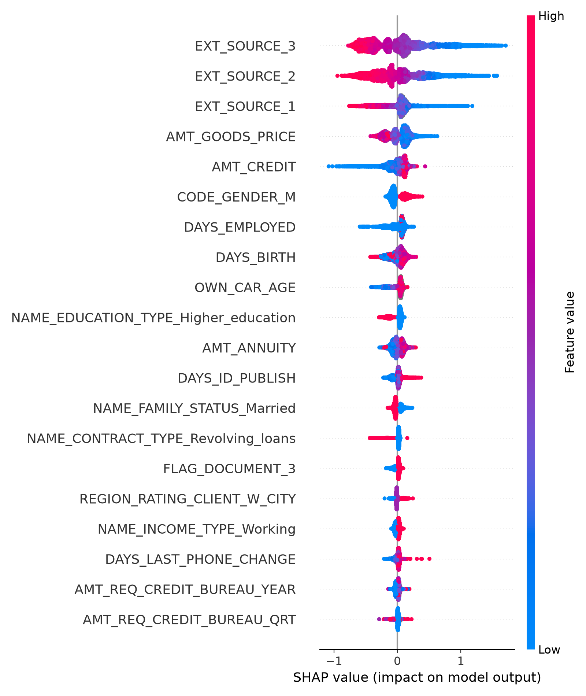
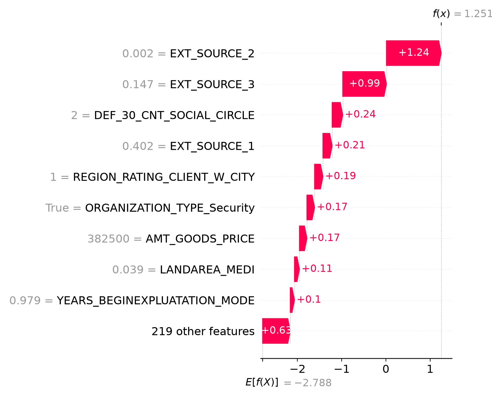
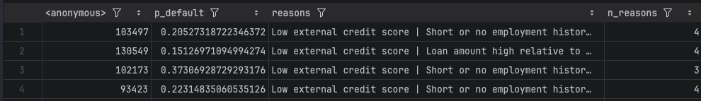

## Week 1: Environment, data and EDA

**Goal.** Get a reproducible local pipeline running and understand the data before modelling.

**Setup.** PyCharm with a Python 3.14 virtualenv on a MacBook Air M2 (no GPU, so every component is sized to run locally). Git with a GitHub remote over SSH; `data/`, `.venv/` and `.idea/` are gitignored. The Kaggle API is used only to download the data.

**Data.** Home Credit Default Risk. The main table has ~307K labeled applications and 122 columns. Auxiliary tables (`bureau_balance`, `installments_payments`, `POS_CASH_balance`) are held back for the Week 11 transition-probability work, because they contain real monthly repayment-status histories.

**Findings.**
- Severe class imbalance: 91.9% non-default vs 8.1% default. Accuracy is meaningless here, so the primary metrics are ROC-AUC (threshold-independent, rank-based) and PR-AUC (more sensitive to the minority class).
- Heavy missingness in the building/apartment feature block (up to ~70%). Treatment differs by model: LightGBM and XGBoost handle NaNs natively; Logistic Regression needs explicit imputation.
- Every standard public credit dataset contains only approved applicants. The rejected population is unobserved, which motivates the reject-inference work in Week 6 and is stated as a limitation throughout.

**Design decision.** The professor requires 2-3 datasets. Plan: Home Credit for the core pipeline, LendingClub as a cross-domain base learner and external check, and the UPI transactions dataset to parameterise the simulator. Row-level merging was rejected in favour of methodologically justified roles for each dataset.

---

## Weeks 2-3: Individual baselines

**Goal.** Establish honest single-model numbers that the stacked ensemble must beat.

**Preprocessing.**
- Logistic Regression: drop columns above a missingness threshold (~50-60%) - Logistic Regression: drop columns with 50% or more missing values, add a binary `_MISSING` indicator flag for each remaining column that still has missing values, median imputation, `StandardScaler`.
- LightGBM / XGBoost: raw features, NaNs left as they are.
- Categoricals one-hot encoded.

**Results (test AUC).**
| Model | AUC | Note |
|---|---|---|
| Logistic Regression | 0.7469 | |
| LightGBM | 0.7520 | default params |
| XGBoost | 0.7236 | default learning_rate=0.3, n_estimators=500 |
| XGBoost | 0.7562 | learning_rate=0.05 |

**Interpretation.** XGBoost's first number was an artefact of an untuned learning rate (overfitting at 0.3), not evidence the model is weaker. After tuning it is the best single model. Random Forest was dropped from the design to keep the final stack to three diverse base learners (linear, two boosted-tree libraries).

---

## Week 4: Stacked ensemble

**Goal.** Build the proposed architecture and show whether combining models beats any single one.

**Method.**
- Level 0: LightGBM, XGBoost, Logistic Regression, each trained with 5-fold CV on the training set, producing out-of-fold (OOF) predictions for every training row.
- Level 1: a Logistic Regression meta-learner fitted on the three OOF columns, then evaluated on the true test set.
- *Why OOF:* fitting the meta-learner on in-sample base predictions leaks training labels and inflates it. The design follows the lesson from a top Kaggle solution to trust OOF CV over leaderboard chasing.
- *Why an LR meta-learner:* it only learns three weights, so it can't overfit and stays interpretable. A neural meta-learner (as in the baseline literature) was rejected for the opposite reasons.

**Results.**
- OOF AUC: LightGBM 0.7424, XGBoost 0.7495, LR 0.7435.
- Stack test AUC: **0.7579**, above all three standalone baselines.
- Meta-weights: LightGBM 1.290, XGBoost 3.481, LR 3.950. The meta-learner leans on LR and XGBoost, which suggests LightGBM's information is largely redundant given the other two.

**Caveat.** The weights are on raw OOF probabilities, so treat them as a rough indication of reliance, not a precise ranking of importance.

---

## Week 5: Model comparison

| Model | AUC | PR-AUC |
|---|---|---|
| Logistic Regression | 0.7469 | 0.2297 |
| LightGBM | 0.7520 | 0.2388 |
| XGBoost | 0.7562 | 0.2476 |
| Stacked ensemble | 0.7579 | 0.2485 |

**Interpretation.** The stack is best on both metrics, but its margin over XGBoost is small (+0.0017 AUC, +0.0009 PR-AUC). We claim the ordering, not a large improvement, and test whether the gap is statistically meaningful in Week 12 (repeated runs and DeLong's test).

**Outputs.** `results_summary.csv`, `roc_comparison.png` (ROC overlay), `model_comparison.png` (AUC and PR-AUC bars).

---

## Week 6: Fuzzy augmentation (reject inference)

**Goal.** Test whether adding simulated rejected applicants improves scoring. Each unlabeled applicant is duplicated into a "good" copy weighted P(good) and a "bad" copy weighted P(bad), then the model is retrained with `sample_weight`.

**Experiment A: unlabeled pool (`application_test.csv`).**
- 80/20 labeled split of `application_train` (train_sub / holdout_eval). The pool is 48,744 rows, ~16.5% of total training weight, mean P(default) 0.0788.
- Single run: AUC 0.7594 to 0.7603. Over 5 seeds: mean delta AUC +0.0006 (std 0.0010), PR-AUC -0.0004 (std 0.0010), sign flipping across seeds.
- **Conclusion:** no measurable effect. This is expected, since the pool comes from the same approved population, so there is no selection bias to correct.

**Experiment B: tail-based rejects (genuine selection bias).**
- The bottom 20% of applicants by mean EXT_SOURCE_1/2/3 are held out as "hidden rejects" (true labels kept aside); the rest are "accepts". Reject default rate 18.68% vs 5.42% for accepts, which is real selection bias.
- LightGBM, 5 seeds: mean delta AUC **+0.0060** (std 0.0007) and PR-AUC +0.0064 (std 0.0005) on the hidden rejects, positive in every seed (range +0.0054 to +0.0072).
- XGBoost (seed 42): +0.0061 AUC on rejects, +0.0041 on holdout. This independently confirms the LightGBM effect size.
- **Logistic Regression: delta is exactly 0.0000.** This is a provable no-op, not a bug. A pair duplicated at the model's own predicted p contributes p(1-p) - (1-p)p = 0 to the MLE score equation, so the optimum is unchanged. Tree models are not fit through a linear score equation, so they do shift.

**Stack ablation (in-fold augmentation to avoid leakage).** Baseline vs augmented stack AUC: 0.6646 vs 0.6651 on rejects, 0.7583 vs 0.7584 on holdout. Small but positive on all four metrics. Meta-weights moved: LightGBM 2.012 to 2.707, XGBoost 4.502 to 4.698, LR 6.676 to 6.067.

**Conclusion.** No effect without selection bias; a real ~0.006 AUC gain for tree models when it exists; a structural zero for MLE-linear models; a small positive effect at stack level.

**Outputs.** `fuzzy_augmentation.py`, `fuzzy_augmentation_tail.py`, `fuzzy_augmentation_results.csv`, `fuzzy_augmentation_tail_results.csv`.

---

## Week 7: LendingClub cross-domain transfer

**Goal.** Train a model on LendingClub, use it to score Home Credit applicants, and add that score as a 4th meta-feature. Also report LendingClub standalone as external validation.

**Method.**
1. Column inventory of both datasets and a concept-mapping table (concept | Home Credit column | LendingClub column | notes), giving **5 shared features**: log_income, loan_to_income, payment_to_income, emp_years, owns_property.
2. LendingClub preprocessed on its own terms with its own train/test split.
3. LightGBM trained on the shared features only; LC model scored on Home Credit; meta-learner retrained with 4 inputs.
4. Ablation of the 3-model vs 4-model stack using a paired bootstrap on the test set, reusing the cached 5-fold OOF predictions.

**Results.**
- LC standalone AUC: 0.6713 with raw ratios, 0.6765 after within-domain percentile ranking (medians aligned at ~0.5).
- **Cross-domain AUC on Home Credit: 0.4950 (raw), 0.4987 (percentile), which is chance.**
- Diagnostic: Home Credit's own in-domain AUC with the same 5 features is only 0.6242, so the shared features are weak even in-domain.
- Univariate AUC (LC / HC): log_income 0.451 / 0.481, loan_to_income 0.598 / 0.498, payment_to_income 0.588 / 0.520, emp_years 0.490 / 0.421, owns_property 0.460 / 0.495. Several features carry signal in LendingClub that doesn't transfer, and some flip direction.
- Ablation: 3-model stack AUC 0.7579 / PR-AUC 0.2485 vs 4-model 0.7583 / 0.2488. Delta +0.00038, 95% bootstrap CI [-0.00031, +0.00103], which includes zero. LC meta-weight -0.222; LC score alone on the HC test set AUC 0.4973; correlation with the base OOFs ~0.

**Interpretation.** The LendingClub score adds nothing. The reason is likely that the 5 mappable features are weak and the two populations (US consumer lending vs Home Credit's population) relate to default differently. This is reported as a **negative result with diagnostics**, not hidden.

---

## Week 8: Fairness check

**Goal.** Measure group disparities in the model's decisions. Mitigation is out of scope.

**Method.** Each model approves its lowest-risk 80% using one threshold for all groups. Metrics per group: approval rate, disparate-impact (DI) ratio as a proxy, TPR and FPR gaps, per-group AUC. Slices: `CODE_GENDER`, then `DAYS_BIRTH` age bands.

**Results: gender (all models, baseline vs augmented stack essentially identical).**
- Approval rate: F ~0.85 vs M ~0.70-0.71. Default rates: F 0.070, M 0.102. DI ratio 0.82-0.84.
- TPR gap ~0.19-0.20, FPR gap ~0.12-0.135. Per-group AUC: F ~0.750, M ~0.758, so ranking quality is similar across groups even though approval differs.

**Results: age bands.** DI ratio ~0.66-0.68, TPR gap 0.43-0.49, FPR gap 0.27-0.29. Larger gaps than gender.

**Proxy check (LightGBM, 80% approval).**
| | AUC | Approval F | Approval M | DI |
|---|---|---|---|---|
| With CODE_GENDER_M | 0.7520 | 0.845 | 0.714 | 0.845 |
| Without | 0.7489 | 0.825 | 0.752 | 0.912 |

Dropping gender costs 0.003 AUC and closes about half the DI gap. `CODE_GENDER_M` and `DAYS_BIRTH` are direct model inputs (via `get_dummies`), so this is the model using protected attributes, not just correlated proxies.

**Interpretation.** Part of the approval gap reflects a real default-rate difference between groups (M 0.102 vs F 0.070), not model bias alone. The gaps are still large enough to need disclosure, and age is the bigger issue. Week 9 then asks how much these attributes show up in the model's own explanations.

**Outputs.** `fairness.py`, `fairness_results.csv`, `fairness_summary.csv`.
## Week 9: SHAP adverse-action reasons

### Setup
- Model: LightGBM, holdout AUC 0.759.
- SHAP: TreeExplainer; global plots on an 8K holdout sample, reasons on all rejected applicants. Reconstruction error ~1e-14.
- Rejection rule: riskiest 20% of the holdout (80% approval), 12,301 applicants.

### Global findings
- EXT_SOURCE_1/2/3 dominate, with directions matching expectations.
- AMT_CREDIT and AMT_GOODS_PRICE push in opposite directions (collinearity), so they are merged into one loan-to-goods reason.
- Age effect is non-monotonic (lowest under 30 and over 55, peak in the mid-30s), probably through interactions with the external scores.
- OWN_CAR_AGE is 65.8% missing and has placeholder values at 64-65 years. It is used by the model but not reported.

### Reason generation
- SHAP values are summed within reason groups, groups are ranked, and a group is reported only if it contributes more than 0.02 log-odds toward default; at most 4 reasons per applicant.
- Not reported: protected attributes (gender, age, marital status); education type; social-circle counts; building-statistics columns; application hour; OWN_CAR_AGE; document and work-phone flags.
- 92.6% of rejects receive 4 reasons, 5.6% receive 3, and 1.9% (228) receive fewer than 3.

### Reason frequency (share of rejected applicants)

### Fairness
- A protected attribute appears in the top three unfiltered SHAP drivers toward default for 31.5% of rejected applicants (gender 21.0%, age 11.2%, marital status 0.9%).
- These features are excluded from the reported reasons, so for those applicants the reported reasons omit part of the model's actual explanation. Removing protected attributes from the explanation does not remove their influence on the decision.
- Waterfall plots show the full model explanation; reported reasons are the filtered subset.

### Limitations
- "Low external credit score" appears for 97.6% of rejects, so the model is essentially external-score-driven.
- "Residential region risk rating" (20.4%) is a possible geographic proxy.
- The 0.02 threshold and the 4-reason cap are design choices, not tuned.

### Figures
shap_beeswarm.png, shap_bar.png, shap_dep_DAYS_BIRTH.png, shap_dep_OWN_CAR_AGE.png, waterfall_{clear_cut,borderline,typical}.png

## Week 10: Counterfactual guidance (DiCE)

### Smoke test (unconstrained)
- **Setup:** DiCE (`dice-ml`, random method) wrapped around the Week 9 LightGBM model, run on Python 3.14. Background data: 5,000 training rows, median-filled, cast to float (DiCE rejects the boolean dummy columns that `get_dummies` produces).
- **Decision boundary:** DiCE flips at p = 0.5, but the rejection rule is p > 0.118 (riskiest 20% of holdout). A wrapper rescales the model's log-odds so that p = cutoff maps to 0.5, making "desired class 0" mean "approved at our cutoff".
- **Test case:** the borderline rejected applicant (row 187299, p = 0.1182 vs cutoff 0.1182). Three counterfactuals found; re-scoring with the real model gives p = 0.081, 0.098, 0.098, all below the cutoff.

### Finding: unconstrained counterfactuals are not actionable
Allowing `AMT_CREDIT`, `AMT_GOODS_PRICE` and `AMT_ANNUITY` to vary freely produced:
- goods price +54% (612,000 to 940,850) with everything else unchanged;
- annuity increased 5-6x (35,091 to 205,293 and 175,596) with everything else unchanged;
- `AMT_CREDIT` never changed.

Each counterfactual flips the model's decision but none is advice an applicant could follow. Raising the loan or repayment amount to *lower* predicted risk reflects how the model scores unusual feature combinations (consistent with the Week 9 beeswarm, where higher goods price pushes toward repayment), not a causal effect. Counterfactuals are model-based and say nothing about what a lender would actually approve.

### Design decision: constrain the action space
- Only loan terms can change, and only downward: `AMT_CREDIT` and `AMT_ANNUITY`, with a maximum 50% reduction.
- Held fixed: `AMT_GOODS_PRICE` (the item being purchased), protected attributes (gender, age, marital status), EXT_SOURCE scores (not directly changeable by the applicant), and all other features.
- Random seed fixed (42): repeated unseeded runs on the same applicant returned different counterfactuals.

### Constrained smoke test
- Same borderline applicant (row 187299), loan terms only, decreases only, max 50% reduction, seed 42.
- Three counterfactuals found; all re-score below the cutoff with the real model (p = 0.087, 0.111, 0.111 vs cutoff 0.118).
- Only `AMT_CREDIT` changed (684,707 to 418,902 / 625,294 / 648,830, i.e. reductions of 38.8%, 8.7% and 5.2%); `AMT_ANNUITY` was not needed.
- The counterfactuals are valid but not minimal: DiCE's random method returned a 38.8% cut when a 5.2% cut also flips the decision. The manual-perturbation baseline (below) finds the smallest flipping change for comparison.
- Caveat: this applicant sits exactly on the cutoff, so small changes are expected. The clear-cut case is evaluated next.

### Counterfactual generation (33 rejected applicants)
- **Sample:** the three Week 9 showcase applicants (rows 134750, 187299, 45367) plus 30 random rejected applicants (fixed seed 42).
- **Constraints:** only `AMT_CREDIT` and `AMT_ANNUITY` may change, decreases only, at most 50% reduction; everything else fixed. Three counterfactuals requested per applicant (DiCE random method, seed 42).
- **Validation:** every counterfactual is re-scored with the real LightGBM model and kept only if p(default) falls below the 0.118 cutoff. DiCE's own flip check is not relied on.
- **Method note (NaN handling):** DiCE needs complete data, but LightGBM treats missingness as a signal, so filling NaNs with medians changes an applicant's score (e.g. row 134750 scored 0.665 after filling vs 0.777 on the raw row). The first run therefore included applicants who were not actually rejected, and its validity figure was inflated (25 of 33, discarded). The final run scores the raw row, restores each applicant's own missing-value pattern on every candidate counterfactual, and asserts that every selected applicant is rejected under the real model.

### Results: validity
Validity = at least one counterfactual with a loan reduction of at most 50% confirmed by the real model.

| Risk band (p_original) | With a counterfactual | Share |
|---|---|---|
| 0.118 to 0.15 | 10 of 11 | 91% |
| 0.15 to 0.20 | 4 of 14 | 29% |
| above 0.20 | 0 of 8 | 0% |
| **All** | **14 of 33** | **42%** |

- Counterfactuals exist up to p = 0.189; none were found above that. This includes the clear-cut showcase applicant (p = 0.777) and the typical one (p = 0.179). The borderline showcase applicant (p = 0.118) has three.
- Within the middle band the pattern is not monotonic (e.g. an applicant at p = 0.128 has none while one at p = 0.189 does), so some "none found" cases may reflect the limits of DiCE's random search rather than true infeasibility. DiCE's random method is not exhaustive, so 42% is treated as a lower bound pending the manual baseline.
- For high-risk applicants, loan-size changes within the 50% cap cannot reach approval. The deciding factor for these applicants is the external credit scores (97.6% of rejects, Week 9), which are not something an applicant can change directly.

### Results: which lever DiCE uses
- Both levers are used. For 5 of the 14 applicants with a counterfactual, at least one counterfactual lowers only the annuity and leaves the credit amount unchanged; for 1 of them every counterfactual is annuity-only. The two kinds of advice differ ("pay less per month, e.g. over a longer term" vs "borrow less"), so they are reported separately in the comparison with the manual baseline.
- DiCE does not search for the smallest change: for the borderline case it returned both a 38.8% and a 5.2% credit cut, and both flip the decision. Its counterfactuals are valid but not minimal.

### Manual perturbation baseline
- **Method:** for each of the same 33 rejected applicants (real row, NaNs intact), loan terms are scaled down in 0.5% steps up to the 50% cap and the smallest reduction that brings p(default) below the cutoff is recorded. Three strategies: credit only, annuity only, both scaled together.
- **Feasibility:** 16 of 33 (48%) can be flipped by at least one strategy, versus 14 of 33 (42%) for DiCE. Credit-only flips 11 (median cut 33.5%), annuity-only 8 (median 31.8%), both together 15 (median 33.5%).
- **DiCE vs manual:** every applicant DiCE flipped is also flipped by manual search. DiCE missed two (rows 36213 and 252556), both feasible only at exactly the 50% cap. Manual search also flips no one above p = 0.189, the same limit as DiCE, so the infeasibility of high-risk applicants is not a search artefact.
- **Size of change:** among the 14 applicants both methods flip, the median smallest reduction is about 32% (manual) vs about 36% (DiCE); DiCE is as small as manual in some cases and roughly twice as large in others (e.g. row 91339: 20% vs 41%).
- **Non-monotonic response:** reducing both levers together is not always better than reducing one (row 124056 flips at -12.5% annuity-only but needs -16.5% when credit is cut too; row 185615 flips annuity-only at -48% but never when credit is also cut). The feasibility count therefore uses the best of the three strategies.
- **Not all near-cutoff applicants are flippable:** row 90260 (p = 0.128) cannot be flipped within the 50% cap by any strategy, while row 199782 (p = 0.189) can. Feasibility depends on how strongly an applicant's score responds to loan terms, not only on distance from the cutoff.

### Evaluation of counterfactuals (DiCE vs manual perturbation)
- **Validity:** DiCE 14 of 33 (42%); manual search 16 of 33 (48%). Nobody above p = 0.189 can be flipped by either method.
- **Proximity:** among the 14 applicants both methods flip, the median smallest loan reduction is 32.0% (manual) vs 36.2% (DiCE). DiCE needed more than 5 percentage points extra for 2 of the 14.
- **Sparsity:** 25 of 42 DiCE counterfactuals change one lever and 17 change both. Manual search changes one lever, or both together at a common scale.
- **Plausibility:** treated as the loan term implied by credit / annuity. A counterfactual counts as plausible if its implied term is at most the 99th percentile of the training data (37.8 months). No lower bound is applied, since paying a loan off faster is a realistic action. 38 of 42 DiCE counterfactuals (90%) pass; the 4 that fail (two applicants, rows 185615 and 168515) are annuity cuts of 35-50% that lengthen the term to 38-41 months. All 8 manual annuity-only flips pass. The bound is a design choice; it checks the term implied by the two levers and says nothing about what a lender would offer.
- **Examples:** the borderline applicant (p = 0.118) needs a 1% reduction; a mid-range one (p = 0.131) a 4% reduction; applicants flippable only at the 50% cap sit at p = 0.156 and 0.186. The typical and clear-cut Week 9 showcase applicants (p = 0.179 and 0.777) have no feasible counterfactual.
- - Counterfactuals found by minimal search sit just below the cutoff (for two of the three charted applicants, p falls only about 0.0015 under it), so the advice has little margin; a larger reduction would be needed for a robust approval.
- The model is a tree ensemble, so p(default) changes in steps as a feature crosses a split threshold: a 1% loan cut moves the borderline applicant's score by 0.0076, while larger cuts can be needed elsewhere. Counterfactual size is therefore not proportional to distance from the cutoff.

## Week 11: Simulator data (in progress)

### Home Credit auxiliary tables
- `bureau_balance`: 27.3M monthly rows over 817,395 credits (median 26 months of history, max 97). STATUS shares: C 50.0%, 0 27.5%, X 21.3%, 1 0.89%, 5 0.23%, 2 0.09%, 3 0.03%, 4 0.02%.
- Coverage: 774,354 of 1,716,428 `bureau` credits (45%) have monthly history; 92,231 of 307,511 training applicants (30%) have at least one such credit. The simulator therefore cannot use an applicant's own bureau history for 70% of applicants.
- Month-to-month transitions (consecutive months only), selected rates: 0→0 85.8%, 0→1 2.0%; 2→3 30.2%, 3→4 54.0%, 4→5 66.1%; 5→5 91.3%; C→C ~100%; X→X 87.6%. Late states roll upward, consistent with forward time.
- `installments_payments`: 13.6M rows; 8.4% paid late, 0.3% more than 30 days late, 9.4% underpaid by more than 1 unit; median payment 6 days early, 99th percentile 18 days late.
- Caveats: `bureau_balance` is history with other lenders (a proxy for Home Credit behaviour); transitions are counted per credit, not per applicant, so applicants with many credits carry more weight.

### State space (provisional)
Current, Late 1-30, Late 31-60, Late 61-90, Late 91-120, Default (code 5: 120+ days past due or sold/written off), Closed. Status X (unknown, 21% of rows) is excluded: transitions into or out of X are dropped and rows renormalised. Closed is absorbing; Default is treated as absorbing in the simulator (91% of observed 5→5 transitions). Codes 2-4 are kept separate because the delinquency ladder is the main dynamic and every row has thousands of transitions.

### UPI dataset
- Source: `skullagos5246/upi-transactions-2024-dataset` (Kaggle, CC0). 250,000 transactions dated 2024-01-01 to 2024-12-30; 17 columns; no missing values. The project plan referred to a 2023 dataset; the 2024 one is used.
- Provenance: likely synthetic. Category shares are round (20.0%, 15.0%, 10.0%, 8.0%, 8.0%, 3.0%...), the non-success rate is 4.95%, log-amounts are almost exactly symmetric (skew 0.03), and monthly volume is flat with no seasonality. It is treated as a source of scenario parameters, not as evidence about real spending behaviour.
- Limits: no user or account identifier and no balance, so individual trajectories and balance trends cannot be built and the data cannot be joined to Home Credit applicants. Only population-level parameters are used.
- Parameters taken: amount distribution (lognormal, log-mean 6.500, log-std 1.187; median 629 INR, 99th percentile 9,003 INR); category mix (Grocery 20.0%, Food 15.0%, Shopping 11.9%, Fuel 10.0%, Other 9.9%, Utilities 8.9%, Transport 8.0%, Entertainment 8.0%, Healthcare 5.1%, Education 3.0%); monthly volatility of total spend (std of month-over-month change ≈ [fill in from upi_params.json]%, from 11 changes, so only a rough scenario setting).
- The link between spending shocks and delinquency is a modelling assumption: the UPI data contain no repayment outcomes. Results involving it are reported as a sensitivity analysis, not as an estimated effect.
- Age group and state are not used, consistent with the fairness analysis (Weeks 8-9).

 ### Transition matrices (CP3)
- Method: `bureau_balance` sorted per credit; transitions counted only between consecutive months, with status X (unknown) dropped. 27,299,925 rows give 20,326,767 usable transitions over 707,702 credits. Seven states: Current, Late 1-30, 31-60, 61-90, 91-120, Default (code 5), Closed.
- Pooled matrix (selected rows): Current stays 92.6%, goes to Late 1-30 2.1%; Late 1-30 returns to Current 49.6%; 31-60 to 61-90 31.5%; 61-90 to 91-120 55.4%; 91-120 to Default 69.1%; Default stays 94.1%; Closed is absorbing.
- Segmenting by the applicant's `TARGET` (labeled transitions only, 11.15M, 55% of the total; 421,664 credits for TARGET 0 and 37,192 for TARGET 1): defaulters go from Current to any late state at 3.15% vs 2.23% (ratio 1.41). Later ladder ratios are 1.08-1.16 and rest on small counts (defaulters: 1,515, 649 and 438 transitions in the last three late states), so only the Current row is segment-specific in the simulator and the later rows are pooled.
- Caveats: counts are per credit-month, not per applicant, so effective sample sizes are smaller than the raw counts; `TARGET` describes the Home Credit loan while `bureau_balance` covers other lenders; only 30% of applicants have bureau history.
- - Link check: of 817,395 credits with monthly history, 5.3% are not in `bureau.csv`, 64.0% belong to training applicants (labeled) and 30.7% to test applicants (unlabeled). Unlabeled credits contribute only to the pooled matrix.

### Baseline simulator (CP4)
- Design: 5,000 applicants sampled from the holdout, 500 independent 24-month paths each, all starting in Current. States as in the transition matrices; Closed and Default(5) are absorbing. The Current row is a mixture of the non-defaulter and defaulter Current rows weighted by the model's predicted default probability (a modelling assumption); all other rows are the pooled matrix. No UPI effect in this version.
- Results by risk quintile (safest to riskiest): ever late 24.9% to 26.7%; reaches Default(5) 0.88% to 0.97%; mean late months 0.62 to 0.68; closed at month 24 about 74% in every quintile. Overall: ever late 25.4%, reach Default 0.91%.
- Interpretation: delinquency behaviour in the bureau data separates only weakly by predicted risk (monthly Current-to-late rate 3.1% vs 2.2% for defaulters vs non-defaulters), so the simulator's risk gradient is small and is bounded by that ratio and by the mixture assumption.
- Limitations: homogeneous chain with no memory of loan age or term (constant ~5% monthly closure, so about 74% of loans are closed at 24 months and stop accruing lateness); everyone starts Current; per-applicant estimates rest on few paths and are not reported; the 0.91% default-reach rate is not comparable to the 8.1% `TARGET` rate (different event and lender).

### Simulator robustness (CP5)
- Train-only matrices: segmented matrices re-estimated after removing the credits of the 20% holdout applicants (2,237,203 of 20,326,767 transitions). Current-to-any-late ratio, defaulters vs non-defaulters: 1.4165 (1.41 with all applicants). Simulator outputs changed by 0.003 or less, so label leakage from the original matrices was immaterial; the train-only matrices are used from here on.
- Seed stability: two seeds (42, 7) give overall ever-late 25.46% vs 25.43%, reach Default(5) 0.89% vs 0.88%, closed at month 24 74.24% vs 74.22%, mean late months 0.636 vs 0.633. The risk-quintile gradient is reproduced in both runs.

### Stress scenario (CP4b)
- Design: each simulated month, one shock is drawn per path from the 11 standardized month-over-month changes in total UPI spend (std of the raw changes 3.92%) and shared by all applicants. The shock multiplies only the Current to Late 1-30 probability by exp(beta x shock), divided by its average over the 11 values so the average multiplier is 1. beta is a sensitivity setting with no empirical basis (before normalization, a one-standard-deviation month scales the probability by e^beta); beta = 0 is the plain chain. All betas use identical random draws.
- Results over 500 paths (5,000 applicants, 24 months, seed 42): ever-late mean 25.4% / 25.3% / 25.2% / 24.9% for beta 0 / 0.5 / 1 / 2, but the across-path standard deviation grows from 0.007 to 0.022, 0.043 and 0.078, and the 95th-percentile ever-late share from 26.5% to 29.1%, 32.8% and 38.7%. The share of applicants late in the worst month of a path (95th percentile) rises from 3.9% to 5.7%, 8.4% and 13.9%. Mean default-reach is flat at 0.88%; its 95th percentile rises from 1.08% to 1.32%.
- Interpretation: correlated shocks widen the distribution of portfolio outcomes without changing the average. The beta = 0 spread (0.007) equals sampling noise from 5,000 applicants. The small drop in the mean is consistent with ever-late being concave in the monthly rate.
- Limitations: UPI contributes only the shape of the shock (11 values, resampled independently, no persistence, population level, likely synthetic); the link between spending shocks and delinquency is assumed, not estimated, so results are a sensitivity analysis and not evidence about UPI; the shock affects only the first late transition, which dilutes its effect on defaults; beta = 2 is an extreme setting.

### Week 11 summary: Markov delinquency simulator
- Data roles: `bureau_balance` (27.3M monthly status rows; 20.3M usable transitions) supplies the transition matrices, with `bureau` linking credits to applicants and `application_train` supplying `TARGET` for segmentation; `installments_payments` is used only to describe payment behaviour; the UPI file supplies the shape of the stress shock.
- Model: seven-state monthly chain (Current, Late 1-30, 31-60, 61-90, 91-120, Default(5), Closed). Pooled matrix for all rows except Current, whose row mixes the non-defaulter and defaulter rows by each applicant's predicted default probability. Closed and Default(5) are absorbing.
- Validation: matrices fitted without the holdout applicants' credits and compared with those credits' real 24-month behaviour. Reach-default (1.01% empirical vs 0.89% simulated) and mean late months (0.600 vs 0.636) are reproduced; ever-late is overestimated (17.3% vs 25.5%) and closure underestimated (82.5% vs 74.2%), consistent with persistent heterogeneity between credits that a homogeneous chain cannot represent.
- Risk gradient: weak, because bureau behaviour separates only weakly by predicted risk (Current to any late 3.16% vs 2.23% per month for defaulters vs non-defaulters). Across predicted-risk quintiles, ever-late rises from 24.9% to 26.8%, and default-reach from 0.86% to 0.95%.
- Stress sweep: a shared monthly shock affects only the first late transition. It leaves the means almost unchanged and widens the distribution of portfolio outcomes (95th-percentile ever-late 26.5% to 38.7% for beta 0 to 2). beta is a scenario setting with no empirical estimate; UPI supplies only the shock shape.
- Not claimed: the 0.9% default-reach rate is not comparable with the 8.1% `TARGET` rate (different event, different lender); no causal effect of spending behaviour on delinquency is estimated; the UPI data are likely synthetic and cannot be linked to applicants.

Figures: `transition_matrix_heatmap.png`, `empirical_vs_simulated.png`, `stress_sweep.png`.

## Week 12: Is the stack's edge real?

### Design
Test set: n = 61,502 held-out loans. Six comparisons in two families.

**Primary family (planned before running, Holm-corrected over 4 tests):**
stack vs XGBoost, stack vs LightGBM, stack vs LR, XGBoost vs LightGBM
(all base models are the standalone single fits from Week 5).

**Exploratory family (added after seeing the cached results, Holm within its own pair):**
stack vs bagged XGBoost, bagged XGBoost vs standalone XGBoost.

Two tools, answering different questions:
- **DeLong (paired):** uncertainty from the finite test set, for one fixed pair of trained models.
- **5 repeated runs (new stratified 80/20 split and training seed each):** variation from the data split and training randomness. Reported as mean ± std and the number of seeds in which the stack beats XGBoost. No p-value from n = 5, and the splits overlap, so the std understates true uncertainty.

**Decision rule (fixed before running):** the stack "outperforms" XGBoost only if the DeLong CI excludes 0 after Holm correction AND the stack wins in at least 4 of 5 seeds. Otherwise the claim is "comparable".

### Validation of the DeLong implementation
- AUCs match `roc_auc_score` to within 1e-15 for all six score vectors (predictions cast to float64; XGBoost's float32 output otherwise causes spurious mismatches).
- Standard error of the stack vs bagged-XGBoost difference: DeLong 0.000698 vs 500-resample bootstrap 0.000719 (within 3%).
- XGBoost standalone scores contain a few ties (61,375 unique values out of 61,502); DeLong handles ties through mid-ranks.

### Test-set metrics

| Model | AUC | PR-AUC |
|---|---|---|
| Stack (LR meta-learner) | 0.7579 | 0.2485 |
| XGBoost (standalone) | 0.7562 | 0.2476 |
| LightGBM (standalone) | 0.7520 | 0.2388 |
| Logistic regression | 0.7469 | 0.2297 |
| XGBoost (5-fold averaged) | 0.7591 | 0.2499 |
| LightGBM (5-fold averaged) | 0.7562 | 0.2495 |

### DeLong results

| Comparison (A vs B) | AUC diff (A−B) | 95% CI | p (raw) | p (Holm) |
|---|---|---|---|---|
| **Primary** | | | | |
| Stack vs XGBoost | +0.0017 | [−0.0001, +0.0035] | 0.057 | 0.057 |
| Stack vs LightGBM | +0.0059 | [+0.0035, +0.0083] | <0.001 | <0.001 |
| Stack vs LR | +0.0110 | [+0.0093, +0.0127] | <0.001 | <0.001 |
| XGBoost vs LightGBM | +0.0042 | [+0.0019, +0.0064] | 0.0003 | 0.0006 |
| **Exploratory (post-hoc)** | | | | |
| Stack vs bagged XGBoost | −0.0012 | [−0.0026, +0.0002] | 0.083 | 0.083 |
| Bagged XGBoost vs standalone XGBoost | +0.0029 | [+0.0018, +0.0041] | <0.001 | <0.001 |

### Why the base-model numbers differ from Week 5
The cached test predictions used by the stack are the average of the five
cross-validation fold models (each trained on 80% of train), while the Week 5
standalone models are single fits on all of train. Averaging reduces variance,
so the stack's base learners were stronger than the Week 5 baselines. The
Week 5 gap (+0.0017) therefore compared a bagged stack against un-bagged
models. Both baselines are reported. The bagged comparison was added after
seeing the cached results, so it is labelled exploratory.

### Repeated runs (5 seeds)
TODO after CP3/CP4: table of mean ± std AUC and PR-AUC per model (standalone and bagged),
and the number of seeds in which the stack beats XGBoost.

### Interpretation
- The stack is clearly better than logistic regression and than LightGBM.
- Against a single XGBoost, the stack's +0.0017 AUC is not statistically
  significant after Holm correction (CI barely includes 0, p = 0.057), and the
  effect is small in practical terms.
- Averaging the five fold-trained XGBoost models alone improves on a single
  XGBoost by +0.0029, more than the stack's whole edge. Against that bagged
  XGBoost the stack is 0.0012 lower (not significant, p = 0.083). The stack's
  apparent advantage is attributable to bagging, not to stacking.
- By the decision rule, the stack does not outperform XGBoost.

### Wording change
Week 5: "the stack outperforms XGBoost" is replaced by:
"The stack is comparable to XGBoost (+0.0017 AUC over a single XGBoost, 95% CI
[−0.0001, +0.0035], Holm p = 0.057) and clearly better than LightGBM and
logistic regression; the gain over a single XGBoost is explained by averaging
fold models rather than by stacking."
[Revisit after the repeated-runs results.]

## Week 12: Statistical rigor

### Repeated runs
- Design: 10 seeds (42, 7, 123, 2024, 31, 1, 2, 3, 4, 5). Each seed draws a new stratified 80/20 split; fold assignments and model randomness follow the seed. Standalone models are single fits on the training set; "bagged" models are the average of the 5 fold models used to build the stack's inputs. Preprocessing (imputation, column drops, missingness flags) is fitted once on the full table before splitting, so the seed-to-seed spread understates total variability. Seed 42 reproduces the earlier Week 4-5 results exactly.

| Model | AUC mean (std) | PR-AUC mean (std) |
|---|---|---|
| Logistic Regression | 0.7450 (0.0024) | 0.2229 (0.0043) |
| LightGBM | 0.7482 (0.0029) | 0.2300 (0.0052) |
| LightGBM, fold-averaged | 0.7535 (0.0025) | 0.2392 (0.0063) |
| XGBoost | 0.7537 (0.0027) | 0.2374 (0.0057) |
| XGBoost, fold-averaged | 0.7561 (0.0028) | 0.2408 (0.0055) |
| Stacked ensemble | 0.7555 (0.0026) | 0.2398 (0.0055) |

- Paired differences, stack minus model (AUC, mean difference, seeds where the stack is higher): vs XGBoost +0.0019 (10/10); vs LightGBM +0.0073 (10/10); vs LR +0.0105 (10/10); vs fold-averaged LightGBM +0.0020 (10/10); vs fold-averaged XGBoost -0.0006 (3/10). PR-AUC: +0.0024 (10/10) vs XGBoost, -0.0011 (1/10) vs fold-averaged XGBoost, +0.0005 (6/10) vs fold-averaged LightGBM.
- Interpretation: the stack consistently beats every standalone model, but a fold-averaged XGBoost matches or slightly exceeds it, so the benefit of the stacking layer itself over averaging the best base learner's folds is not demonstrated. Averaging fold models improves XGBoost by about 0.0024 AUC and LightGBM by about 0.0053.
- Caveats: test sets of different seeds overlap, so the paired t-tests (which I do not rely on) are optimistic; differences are small in absolute terms (about 0.002 AUC).

### DeLong's test (seed 42 test set)
- Implementation checked against sklearn (AUC identical to ~1e-16) and a bootstrap (stack vs XGBoost standard error 0.000698 vs 0.000719). Holm correction across the primary family of four comparisons. [Paste the table from `delong_results.csv`: stack vs XGBoost +0.00172, 95% CI [-0.00005, 0.00349], p(Holm) 0.057; stack vs LightGBM +0.00589; stack vs LR +0.01095; XGBoost vs LightGBM +0.00417, p(Holm) 0.0006.]
- Post-hoc comparison (not in the corrected family): stack vs fold-averaged XGBoost -0.00121, p = 0.083.
- Interpretation: on a single split a +0.0017 gap over XGBoost cannot be separated from sampling noise by DeLong's test (the interval just includes zero); the repeated runs show the same sign on all ten splits.

### Fairness uncertainty (Week 12 CP5)
- Method: 1,000 bootstrap resamples of the test applicants; in each, the 80%-approval threshold is recomputed and the metrics are evaluated as in Week 8. Paired comparisons use the same resampled rows for both models. The point estimates reproduce Week 8 exactly. Intervals reflect test-set sampling only, with the fitted models fixed; they do not include variation from retraining or from different splits.

| Model (test set) | Gender DI ratio | Gender TPR gap | Gender FPR gap | Age DI ratio | Age TPR gap | Age FPR gap |
|---|---|---|---|---|---|---|
| Fold-averaged XGBoost | 0.838 [0.830, 0.845] | 0.185 [0.159, 0.212] | 0.121 [0.115, 0.129] | 0.682 [0.671, 0.693] | 0.428 [0.374, 0.479] | 0.270 [0.259, 0.280] |
| Stack | 0.831 [0.823, 0.839] | 0.193 [0.166, 0.220] | 0.127 [0.121, 0.135] | 0.657 [0.647, 0.668] | 0.456 [0.405, 0.507] | 0.294 [0.282, 0.304] |

- Gender disparity stays above the 0.8 reference line in every interval, narrowly; age disparity is far below it (DI 0.66-0.68). Per-group AUC differs little by gender (gap about 0.007, interval including values near zero) but by about 0.05 across age bands.
- Stack minus fold-averaged XGBoost (paired): gender DI -0.0068 [-0.0101, -0.0029], gender FPR gap +0.0060 [+0.0025, +0.0091], age DI -0.0248 [-0.0310, -0.0191], age FPR gap +0.0238 [+0.0181, +0.0305], age TPR gap +0.0273 [+0.0017, +0.0544]; gender TPR gap and AUC gaps not distinguishable from zero. Intervals are not corrected for multiple comparisons. The stack therefore has slightly larger group disparities than a fold-averaged XGBoost, while its accuracy is not better (Week 12), so the interpretable meta-layer carries no measurable accuracy cost but a small fairness cost.
- Augmentation (tail-experiment holdout, augmented minus baseline stack): all eight paired differences have intervals including zero (e.g. gender DI -0.0002 [-0.0022, +0.0026]; age TPR gap +0.0158 [-0.0058, +0.0384]), so no change in the disparities is detected, though the age TPR-gap interval is wide enough that a change of a few points cannot be excluded.